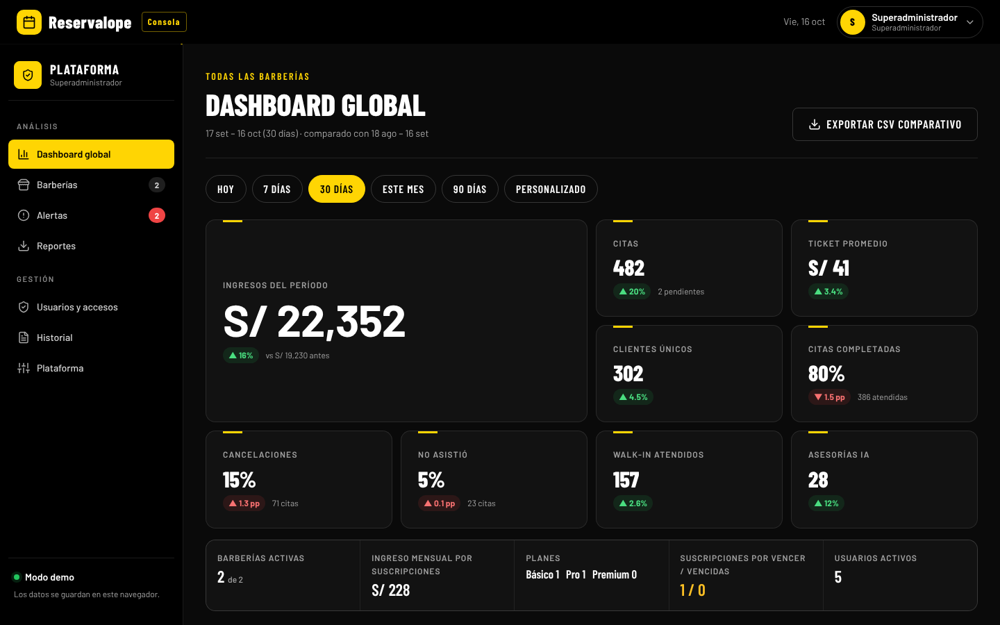
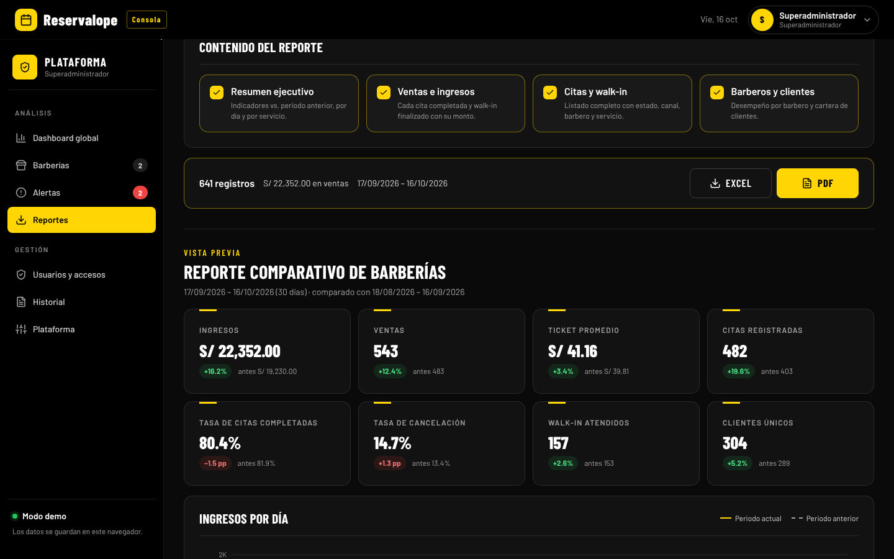
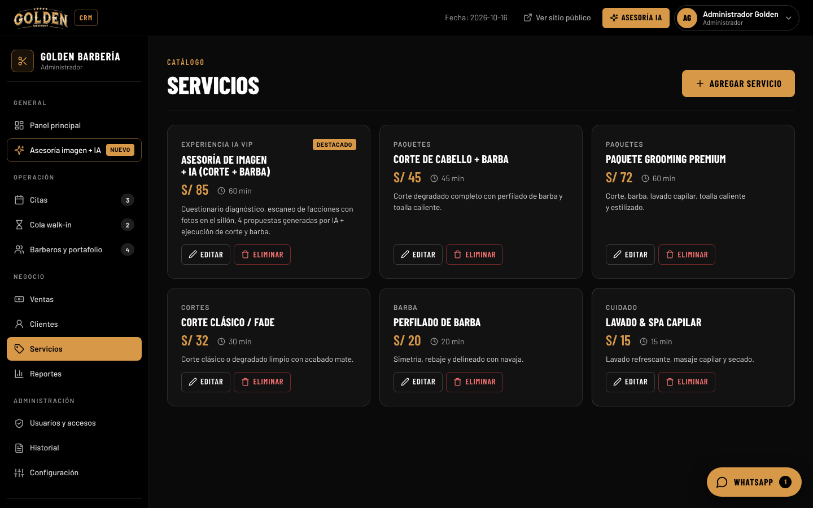
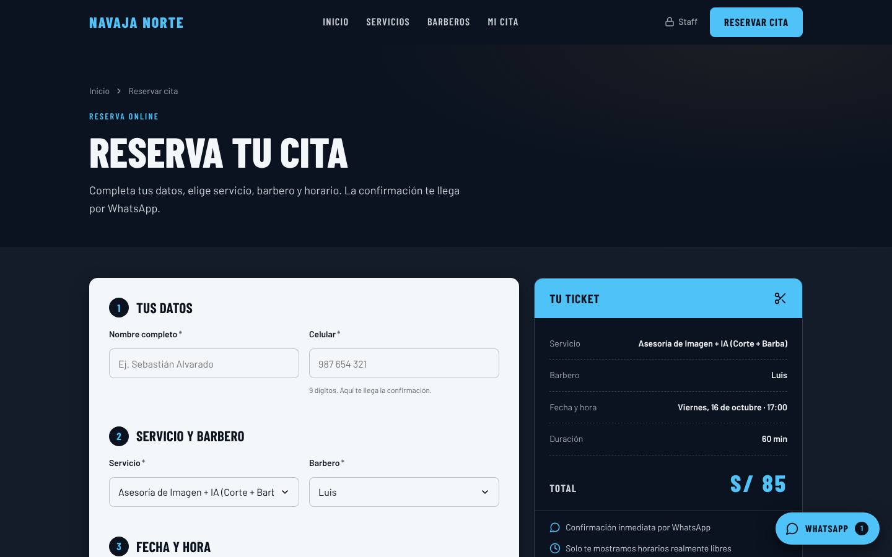
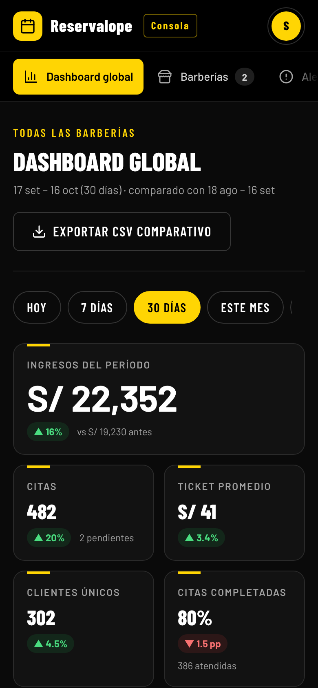

# Reservalope · Citas en línea para cualquier negocio

Plataforma web para administrar **varios negocios** desde un solo sistema: cada negocio tiene su propia web de reservas con su marca, un CRM para su equipo y, por encima de todos, **Reservalope**, la consola del superadministrador con dashboard global, alertas y reportes.

El frontend es HTML, CSS y JavaScript sin frameworks (se publica como sitio estático). Los datos, las cuentas, las fotos y las reglas de acceso viven en **Supabase** (Postgres con RLS, Auth, Storage y Realtime); el navegador solo guarda la sesión. Los mensajes de WhatsApp los envía un bot aparte (ver [bot/](bot/)).



| Reportes con filtros (PDF / Excel) | CRM del negocio |
|---|---|
|  |  |

| Web de reservas con la marca de cada negocio | Diseño responsivo |
|---|---|
|  |  |

---

## Funciones

**Para cualquier negocio con citas**
- Cada negocio elige su **rubro**: barbería, salón de belleza, spa y estética, uñas, consultorio médico, clínica dental, psicología y terapia, veterinaria, estudio de tatuajes, entrenador / estudio fitness u otro.
- Las palabras que se ven cambian con el rubro ("barbero" / "doctor" / "terapeuta", "cliente" / "paciente", "servicio" / "consulta" / "sesión") y el negocio puede personalizarlas. La tabla completa está en [`js/core/vocab.js`](js/core/vocab.js).
- Los nombres internos del código y de la base (`barbers`, `barber_id`, `web_barberia`, `barberos.html`) no cambian.

**Web pública por negocio** (`index.html?b=enlace`)
- Inicio, servicios, profesionales con portafolio, reserva de citas y consulta de "Mi cita".
- Usa el nombre, logo, paleta de 3 colores y datos de contacto de cada negocio.
- No permite reservar en días u horarios que ya pasaron, ni en horarios ocupados.

**CRM del negocio** (`crm.html`)
- Panel principal, citas, cola walk-in, profesionales y portafolio, servicios (agregar, editar, eliminar), ventas, clientes, reportes, usuarios, historial y configuración.

**Roles y permisos**
- **Superadministrador:** acceso total; crea negocios y usuarios.
- **Administrador:** solo su negocio; crea personal; módulos extra según lo que le otorgue el superadministrador.
- **Personal:** ve el panel, crea y gestiona citas y walk-in (solo sus propias citas si está vinculado a un profesional).
- Cuentas en Supabase Auth, cambio obligatorio de contraseña temporal, sesión con caducidad y cierre por inactividad, e historial de actividad.

**Reservalope · consola del superadministrador** (`reservalope.html`)
- Dashboard global con comparación contra el periodo anterior, ranking de negocios, ingresos por suscripciones.
- Ficha individual de cada negocio, alertas de salud (suscripción, cancelaciones, inactividad, configuración), exportación CSV.
- Creación de negocios con paleta de 3 colores validada por contraste, plan y vencimiento.

**Reportes**
- Filtros por periodo, negocio, profesional, servicio, estado, canal, tipo y cliente.
- Vista previa en pantalla y descarga en **PDF** (con la marca del negocio) o **Excel** (varias hojas con formato).

El detalle de roles, reglas y cuentas está en [ACCESOS-Y-ROLES.md](ACCESOS-Y-ROLES.md) y el sistema de diseño en [DESIGN-SYSTEM.md](DESIGN-SYSTEM.md).

---

## Probarlo

### En tu computadora

Se recomienda abrirlo con un servidor local (con doble clic también funciona, pero el logo no aparece en los PDF):

```bash
# Opción 1: Python
python -m http.server 8000
# Opción 2: Node
npx serve .
```

Luego abre <http://localhost:8000>. En VS Code también sirve la extensión **Live Server**.

### Publicarlo con GitHub Pages

1. Sube el proyecto a un repositorio de GitHub.
2. En el repositorio: **Settings → Pages → Build and deployment → Source: Deploy from a branch**, rama `main`, carpeta `/ (root)` → **Save**.
3. En uno o dos minutos queda publicado en `https://TU-USUARIO.github.io/NOMBRE-DEL-REPO/`.

| Página | Enlace (sobre la URL publicada) |
|---|---|
| Página principal de Reservalope (landing) | `landing/` |
| Web de Golden Barbería | `index.html?b=golden` |
| Web de cualquier otro negocio | `index.html?b=ENLACE-DEL-NEGOCIO` |
| Ingreso del superadministrador (marca Reservalope) | `login.html` |
| Ingreso al CRM del equipo de un negocio (con su marca; enlace que se le entrega al cliente) | `login.html?b=ENLACE-DEL-NEGOCIO` |

### Cuentas

Las cuentas viven en Supabase Auth: el superadministrador se crea desde el panel de Supabase y él crea a los administradores y al personal (ver [supabase/README.md](supabase/README.md)). Las contraseñas nunca se publican en este repositorio.

---

## Estructura

```
├── index.html, servicios.html, barberos.html,
│   reservar.html, consultar-cita.html      Web pública (por negocio)
├── login.html                               Ingreso
├── crm.html                                 CRM del negocio
├── reservalope.html                         Consola del superadministrador
├── assets/icons/                            Logos
├── css/
│   ├── variables.css, components.css, layout.css, main.css
│   └── pages/                               Estilos por página (crm, reservalope, reports, analytics…)
├── js/
│   ├── data/      db.js (conexión con Supabase, datos y reglas de agenda)
│   ├── core/      vocab (palabras por rubro), auth, guard (permisos), tenant-brand (marca), analytics, charts, reports, report-export
│   ├── pages/     lógica de cada página
│   ├── components/ modal, WhatsApp, constructor de reportes
│   ├── utils/     iconos SVG, compresión de imágenes
│   └── vendor/    jsPDF, jsPDF-AutoTable, ExcelJS (MIT)
└── docs/capturas/                           Imágenes de este README
```

---

## Seguridad

- Los permisos que muestra la interfaz son solo comodidad: quien decide qué se puede leer o escribir es la base de datos (RLS y funciones de Supabase).
- La clave pública de Supabase (`anon`) que lleva el sitio no da acceso por sí sola; sin sesión solo se pueden usar las funciones públicas de reserva.

---

## Licencias

Las librerías de terceros incluidas y sus licencias se detallan en [THIRD_PARTY_NOTICES.md](THIRD_PARTY_NOTICES.md).
